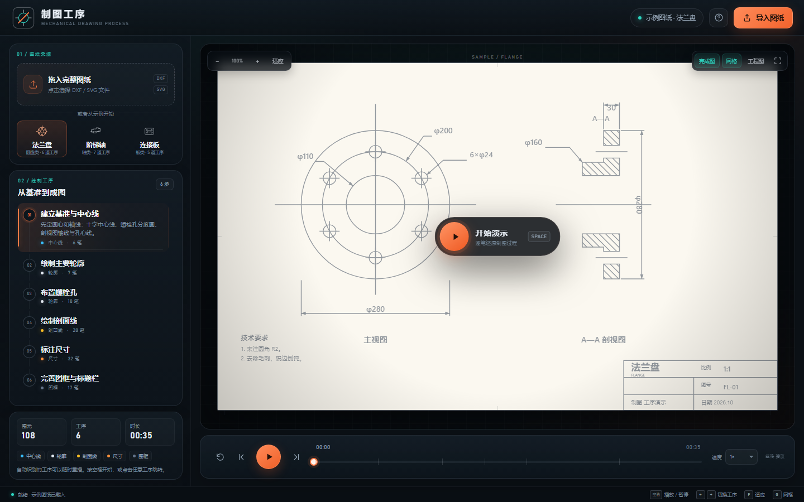
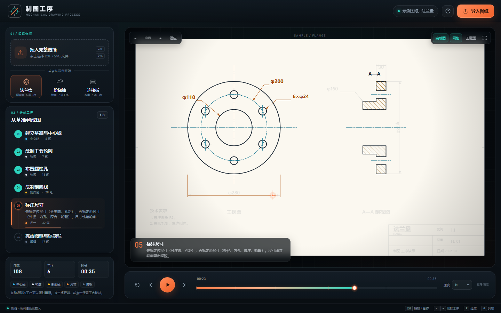
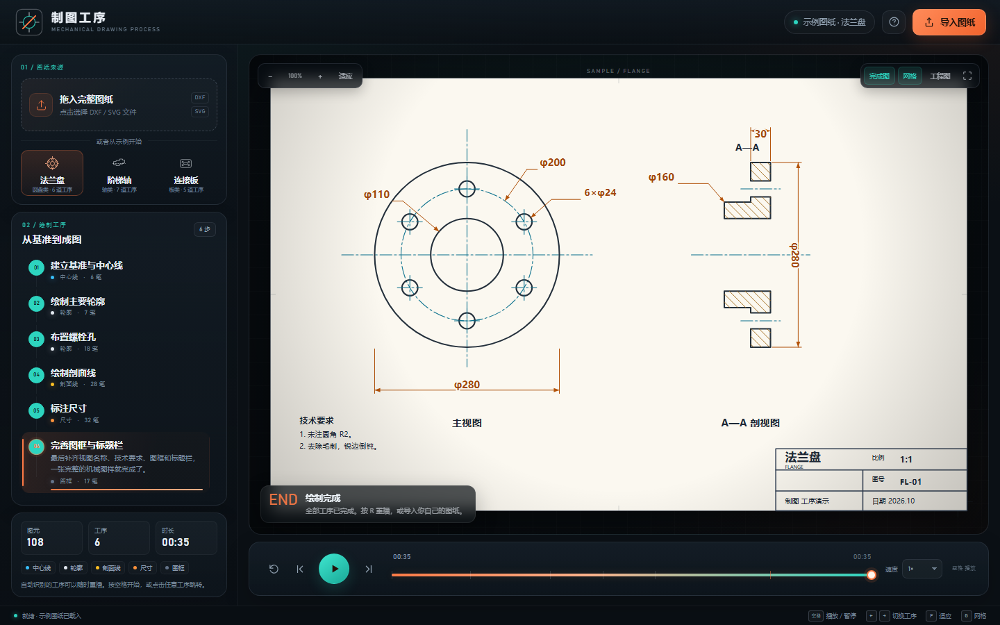
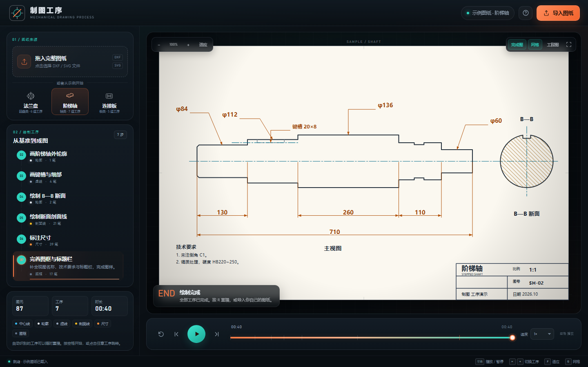
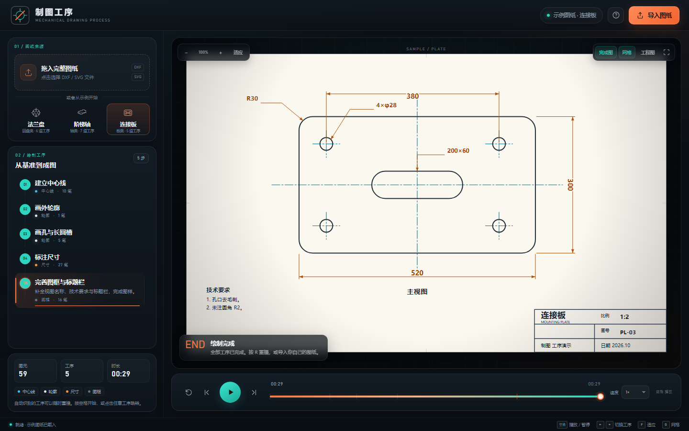

# 制图工序 · Mechanical Drawing Process Player

一个**纯前端、零依赖**的机械制图过程演示软件：导入一张已经画完的 DXF / SVG 图样，自动拆解图元、识别线型与图层，按制图习惯排出工序，再用“笔尖逐笔绘制”的方式把整张图重新画出来。

不需要安装 CAD，不需要后端，不上传文件。双击 `index.html` 就能用。



## 快速开始

1. 保持 `index.html`、`css/`、`js/` 三个部分在同一目录结构中。
2. 用 **Microsoft Edge / Chrome** 打开 `index.html`（直接双击即可）。
3. 点击「开始演示」，或把 DXF / SVG 文件拖进页面。
4. 左侧「绘制工序」可以点击跳转；底部可以暂停、拖动进度、调速。

> 建议窗口宽度 ≥ 1200px。较小屏幕会自动切换为上下布局，侧栏可滚动。

## 它做了什么

输入一张**完整图样**后：

1. **解析**：读取 DXF 实体/图层/标注，或读取 SVG 的路径、形状、文字与分组。
2. **分类**：把图元归入中心线、可见轮廓、不可见轮廓、剖面线、尺寸标注、文字、图框。
3. **排工序**：先基准、后轮廓、再细节；先可见、后不可见；最后尺寸、文字、图框。
4. **逐笔动画**：每个图元沿路径展开，笔尖跟随当前位置移动；已经画好的部分保留，未画的部分以淡色底影提示。
5. **可回看**：拖动时间轴、点击工序、单步跳转、切换黑白工程图模式、缩放和平移。



## 主要功能

- **DXF 导入**：LINE、CIRCLE、ARC、LWPOLYLINE / POLYLINE（含 bulge 圆弧）、ELLIPSE、SPLINE（采样近似）、TEXT / MTEXT、LEADER、DIMENSION（线性/对齐/半径/直径）、SOLID/TRACE/3DFACE、INSERT 块展开。
- **SVG 导入**：path、line、polyline、polygon、rect、circle、ellipse、text；保留分组名称（如“中心线”“轮廓”“尺寸”）；支持变换、虚线/点划线识别、填充箭头；文字会转成可逐条淡入的图元。
- **自动工序**：按图层名称、线型、几何连通关系与空间位置排序；轮廓按连通块从大到小安排。
- **可编辑的示例**：内置法兰盘、阶梯轴、连接板三张教学示例，覆盖圆盘类、轴类、板类。
- **播放控制**：播放/暂停、重播、上一道/下一道工序、拖动进度、0.5×–2× 调速、全屏。
- **视图**：自适应窗口、缩放、拖拽平移、网格开关、完成图底影开关、工程图黑白配色。
- **尺寸重建**：对 DXF 中的常见尺寸标注重新绘制尺寸线、箭头和文字，并自动留出文字底衬。
- **纯本地**：所有解析和绘制都在浏览器内完成；没有网络请求、没有第三方库。



## 快捷键

| 快捷键 | 功能 |
| --- | --- |
| `空格` | 播放 / 暂停 |
| `←` / `→` | 上一道 / 下一道工序 |
| `R` | 重播 |
| `F` | 适应窗口 |
| `G` | 显示 / 隐藏网格 |
| `Home` / `End` | 跳到开头 / 结尾 |
| `Esc` | 关闭帮助对话框 |

鼠标滚轮缩放，按住空白处拖动平移，双击画布适应窗口。

## 支持的输入与边界

### DXF

- 支持 **ASCII DXF**，读取模型空间（`ENTITIES`）与块定义（`BLOCKS`）。
- 支持图层名与线型识别，例如：
  - `CENTER` / `中心线` / `AXIS` → 中心线
  - `HIDDEN` / `虚线` → 不可见轮廓
  - `DIM` / `标注` / `尺寸` → 尺寸标注
  - `HATCH` / `剖面` → 剖面线
- 常见尺寸标注会重建；复杂标注样式、公差、引线样式可能与原 CAD 略有差异。
- **HATCH 填充暂不重建**，会在图注中提示跳过；如果原图依赖填充表达剖面，建议先炸开或导出为 SVG。
- 不支持二进制 DXF、三维实体、光栅图像、动态块参数。

### SVG

- 支持基础形状、路径、文字、分组与常见变换。
- 建议保留分组名称或 `id`，便于识别中心线、虚线、尺寸、文字。
- 图片、滤镜、遮罩、渐变填充、外部字体等 Web 特性可能被忽略或简化。
- SVG 的线条会沿路径采样后展平，以便逐笔动画；极大或极复杂的 SVG 可能变慢。

### 不支持

- **PNG / JPG 自动识图**：当前版本不做栅格图像到矢量的自动识别。若只有截图/照片，请先用 CAD 导出 DXF/SVG，或在 Illustrator / Inkscape 中转成 SVG。
- 这不是 CAD 编辑器：不能修改尺寸、捕捉对象或生成加工文件；它只负责“把完成图倒推成制图过程”。

## 自动排序是怎么做的

1. **线型/图层判定**：优先看图层名称、线型名称，再看虚线模式。
2. **阶段顺序**：中心线 → 可见轮廓 → 剖面线 / 不可见轮廓 → 尺寸 → 文字 → 图框。
3. **轮廓排序**：按端点连通关系把图元分成连通块，大块优先；块内用最近邻减少空走。
4. **尺寸重建**：将 DXF 的尺寸定义点映射到页面坐标，重新生成尺寸线、箭头和文字。
5. **教学示例**：`js/samples.js` 中人工编排了更符合课堂讲解的工序，所以示例的顺序比任意导入图更“像老师画的”。

自动排序是启发式的。如果导入图的图层命名比较规范，效果会明显更好。

## 目录结构

```
.
├── index.html              # 应用入口
├── css/
│   └── style.css           # 界面与工程图样式
├── js/
│   ├── geom.js             # 几何 DSL、路径、剖面线、尺寸绘制
│   ├── samples.js          # 三个内置教学示例
│   ├── dxf.js              # ASCII DXF 解析与自动工序
│   ├── svg.js              # SVG 解析、采样与自动工序
│   └── app.js              # 播放器、渲染、交互
├── examples/
│   ├── sample-bracket.dxf  # 可导入的 DXF 示例
│   └── sample-plate.svg    # 可导入的 SVG 示例
├── screenshots/            # 界面截图
└── README.md
```

## 二次开发

- **增加示例图纸**：在 `js/samples.js` 里用 `MD.Geom.Builder` 添加绘制步骤。坐标空间为 1120×720，页面边框在 32–1088 / 32–688。
- **调整线型/颜色**：`js/geom.js` 的 `STYLES` 与 `css/style.css` 的 `.style-*` 类。
- **调整动画速度**：`js/app.js` 的 `primitiveDuration()` 和 `buildTimeline()`。
- **调整自动排序**：`js/dxf.js` / `js/svg.js` 中的 `orderByProximity()`、`packVisible()`、`organise()`。
- **调试参数**：
  - `index.html?sample=shaft&seek=0.66`：载入示例并跳到 66% 进度
  - `index.html?sample=flange&seek=1&mode=engineering`：直接查看黑白工程图
  - `index.html?ghost=0`：关闭完成图底影

## 已验证

- Microsoft Edge（Chromium，无头模式）1440×900、1024×768、900×700。
- 本地 `file://` 直接打开。
- 实际文件输入导入 DXF / SVG、自动解析、播放结束状态。
- 三个内置示例、黑白工程图模式、时间轴/工序跳转。





## 说明

这个项目面向**机械制图教学、工序演示和图纸复盘**，不是生产级 CAD 工具，也不保证任意 CAD 图纸的标注样式完全一致。你可以自由用于教学、课程作业和二次修改；如果用于正式生产图纸，请以原始 CAD 文件为准。
